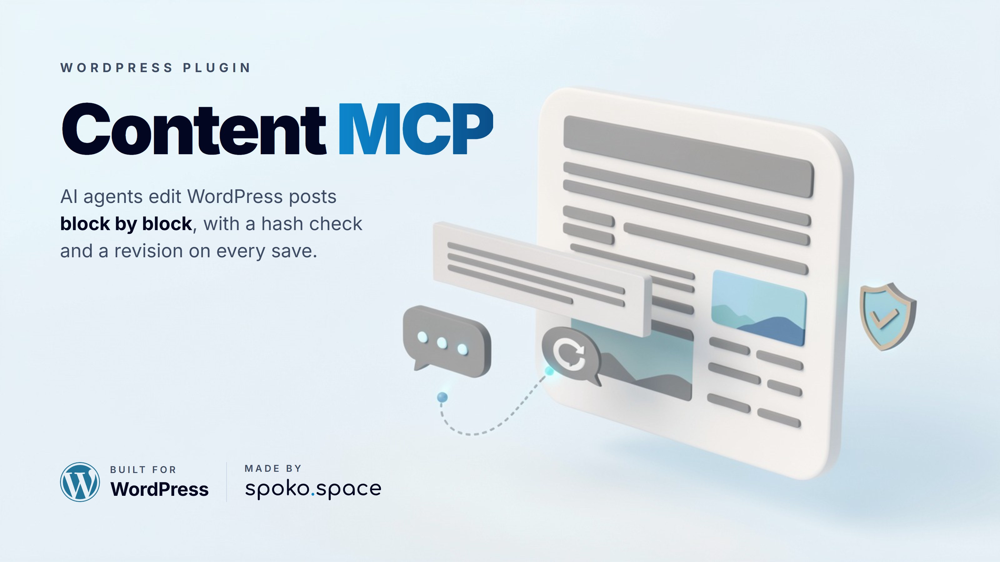

<picture>
  <source media="(prefers-color-scheme: dark)" srcset="art/cover-dark.jpg">
  
</picture>

# Spoko Content MCP

[](https://github.com/spokospace/wordpress-content-mcp/releases)
[](https://wordpress.org)
[](https://www.php.net)
[](LICENSE)
[](https://spoko.space)

A WordPress plugin that lets AI agents (Claude, Cursor, any MCP client) read and edit posts and
their Gutenberg blocks, through the official [MCP Adapter](https://github.com/WordPress/mcp-adapter)
and the [Abilities API](https://make.wordpress.org/core/2025/11/10/abilities-api-in-wordpress-6-9/).

An agent that rewrites a whole post to change one paragraph can break blocks it never meant to
touch, or overwrite an edit someone made a minute ago. This plugin gives it smaller, safer steps:

- **Edit one block, not the whole post.** Blocks are addressed by a path (`12.0.3`), so a change
  replaces, inserts, moves or deletes exactly that block and leaves the rest byte for byte.
- **No lost edits.** Every read returns a `content_hash`; every write needs it. If the post changed
  in the meantime, the write is refused.
- **Look before you save.** Every write takes `dry_run`.
- **Always a way back.** Every save is a normal post update with a revision (`revision_id`).
- **Valid blocks only.** Before saving, the content is checked for broken block structure; if the
  check fails, nothing is saved.

## Requirements

- WordPress 6.9+ (Abilities API in core), PHP 7.4+
- The [MCP Adapter](https://github.com/WordPress/mcp-adapter) plugin
- A WordPress user for the agent (an application password). The tools run with that user's own
  capabilities: `edit_post` for the post, `upload_files` for `find-media`.

## Install

1. Download `spoko-content-mcp.zip` from the [latest release](https://github.com/spokospace/wordpress-content-mcp/releases/latest).
2. **Plugins → Add New → Upload Plugin**, activate it.
3. Turn on **Enable auto-updates** for it: new releases install themselves (see
   [Updates](#updates-and-releases)).
4. Point your MCP client at `https://your-site/wp-json/spoko/content`, e.g. with
   [`@automattic/mcp-wordpress-remote`](https://www.npmjs.com/package/@automattic/mcp-wordpress-remote):

```json
{
  "mcpServers": {
    "spoko-content": {
      "command": "npx",
      "args": ["-y", "@automattic/mcp-wordpress-remote@latest"],
      "env": {
        "WP_API_URL": "https://your-site/wp-json/spoko/content",
        "WP_API_USERNAME": "agent-user",
        "WP_API_PASSWORD": "application password"
      }
    }
  }
}
```

MCP clients list the tools as `spoko-content-<name>`, e.g. `spoko-content-get-outline`. Most
clients read the tool list once when they start, so restart the client after an update that adds
tools.

## Tools

| Tool | Writes | What it does |
|---|---|---|
| `find-posts` | no | Search posts and pages by title text, slug or ID. |
| `get-outline` | no | Block tree with paths, names and text previews, plus `content_hash`. |
| `get-blocks` | no | Serialized markup of blocks by path, plus `content_hash`. |
| `validate-post` | no | Report broken block structure. |
| `find-media` | no | Search the media library: IDs, URLs, image sizes. |
| `replace-block` | yes | Replace the block at a path with new markup. |
| `insert-blocks` | yes | Insert blocks before or after a path. |
| `delete-block` | yes | Delete the block at a path. |
| `move-blocks` | yes | Move consecutive sibling blocks next to another block, markup unchanged. |
| `unwrap-block` | yes | Replace a container (e.g. a group) with its inner blocks. |
| `link-images` | yes | Link every unlinked image of a post to its full-size file. |

A block's **path** is its index in the parsed block tree, joined with dots: `12` is the 13th
top-level block, `12.0.3` the 4th inner block of its 1st inner block. Blank separators between
blocks take an index too, so top-level blocks are usually 0, 2, 4… Get paths from `get-outline`.

Typical edit:

1. `get-outline` → paths and `content_hash`.
2. The write tool with `expected_hash` and `dry_run: true` → check the result.
3. The same call without `dry_run` → saved; `revision_id` is the backup.

### link-images

Lightboxes usually open only images that have a link (`<a href>` around the ``). Images
added with "Link to: None" have none, so the lightbox skips them. For every `core/image` block in
the post, galleries and columns included, `link-images`:

- **links it** the way the editor does for "Link to: Media file": `linkDestination: "media"` and
  `<a href="…">` around the ``. The file is the attachment's full URL (the `-scaled` file for
  big uploads); without an attachment, the `src` without its `-WxH` size suffix;
- **leaves it alone** when it already has a link outside the caption (never a double `<a>`);
- **skips it**, with a reason in `skipped`, when the figure has the class `no-lightbox` (the
  opt-out), the full file cannot be told, or the markup is unexpected.

Nothing else in the post changes, and a second run saves nothing. Images outside `core/image`
blocks (tables, classic content, `core/html`) are out of scope.

**Headless sites:** if the frontend serves the uploads under its own address, set it, and links
point there instead of at WordPress:

```php
// wp-config.php
define( 'SPOKO_CONTENT_MCP_MEDIA_BASE', 'https://example.com/images' );

// or in code, plus old media hosts to rewrite as well:
add_filter( 'spoko_content_mcp_media_base', fn () => 'https://example.com/images' );
add_filter( 'spoko_content_mcp_media_aliases', fn ( array $bases ) => [ ...$bases, 'https://img.example.com' ] );
```

URLs under the uploads base URL (and under the aliases) are rewritten; other hosts are left as
they are. Without a media base, links use the URLs WordPress gives.

## Roadmap

Tools for the rest of a content workflow, with the same hash, dry-run and revision rules:

- creating and updating posts and pages, moving them to the trash;
- categories and tags;
- [Polylang](https://wordpress.org/plugins/polylang/) translations: pairing posts as translations
  of each other (only when Polylang is active).

## Updates and releases

The plugin updates itself from this repo's GitHub releases (`updater.php`), like a plugin from
wordpress.org: the Plugins screen shows the new version, and with **Enable auto-updates** on,
WordPress installs it by itself (WP-Cron, about twice a day; **Dashboard → Updates → Check
again** checks at once). A release counts when its tag is a higher version (`v2.0.1`), it is not
a draft or a prerelease, and it has the asset `spoko-content-mcp.zip`.

Releasing (no CI needed):

1. Bump `Version:` in the plugin header and `VERSION` in the class (the script refuses if they
   differ), add a changelog entry, merge to `main`.
2. On `main`, run `bin/release.sh --publish`. It builds `dist/spoko-content-mcp.zip` (top folder
   `spoko-content-mcp/`) with `git archive` and creates the release `v<version>` with the
   changelog entry as notes. Without `--publish` it only builds the zip. On Windows, run it from
   Git Bash: `bash` started from PowerShell may be WSL, whose git sees the checkout as modified
   and the script refuses.

## Tests

No WordPress install or database needed:

```bash
php tests/link-images.php /path/to/wordpress spoko-content-mcp.php
php tests/updater.php
```

`link-images.php` runs `link-images` against WordPress's real block parser and serializer (from
the given WordPress checkout) with stubs for the rest. `updater.php` checks the updater against
stubbed GitHub responses. Both exit 0 when everything passes.

## Upgrading from Polo Blocks MCP (1.x)

Version 2.0 renamed the plugin (folder `spoko-content-mcp`), its tools (`spoko-content-*`) and its
endpoint (`/wp-json/spoko/content`). WordPress sees it as a new plugin:

1. Install and activate Spoko Content MCP, then deactivate and delete Polo Blocks MCP.
2. Until 3.0 the old endpoint `/wp-json/polo/blocks` serves the same tools, so existing MCP
   clients stay connected. The tools have the new names (`spoko-content-get-outline`, not
   `polo-blocks-get-outline`), so tool allowlists and saved prompts need updating either way.
   Switch clients to `/wp-json/spoko/content` when convenient.

## Changelog

- **2.0.0**: renamed to Spoko Content MCP (repo `wordpress-content-mcp`, tools `spoko-content-*`,
  endpoint `spoko/content`; the old `polo/blocks` endpoint stays until 3.0). Updates from GitHub
  releases (`updater.php`, `bin/release.sh`). The public media address for `link-images` is a
  setting (`SPOKO_CONTENT_MCP_MEDIA_BASE`, filters) instead of a fixed host. MIT license.
- **1.2.1**: `link-images` writes links on a fixed public media address.
- **1.2.0**: `link-images` tool. Write flow split into a shared `save()` step.
- **1.1.0**: first version in this repo.

## Made by spoko.space

<a href="https://spoko.space">
  <picture>
    <source media="(prefers-color-scheme: dark)" srcset="art/spoko-space-logo-dark.svg">
    
  </picture>
</a>

Spoko Content MCP is built and maintained by [spoko.space](https://spoko.space): websites,
online shops and web apps, headless WordPress included. It edits the content of
[blog.polo.blue](https://blog.polo.blue). Questions and ideas are welcome as
[issues](https://github.com/spokospace/wordpress-content-mcp/issues).

## License

[MIT](LICENSE) © [spoko.space](https://spoko.space)
